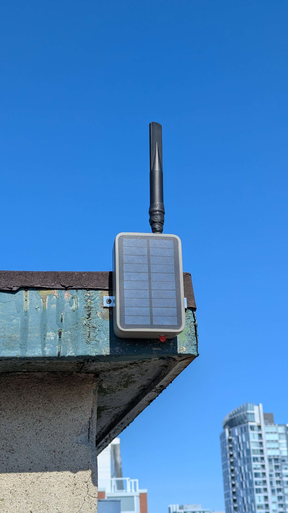
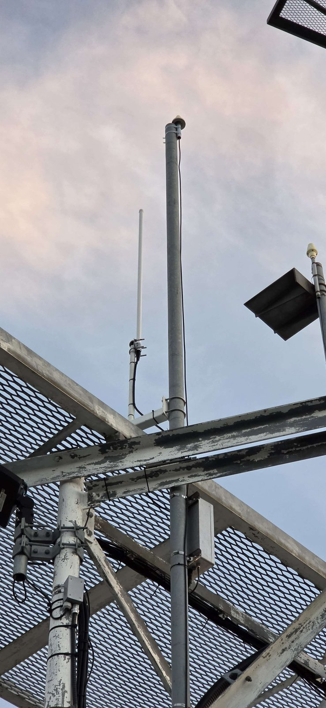
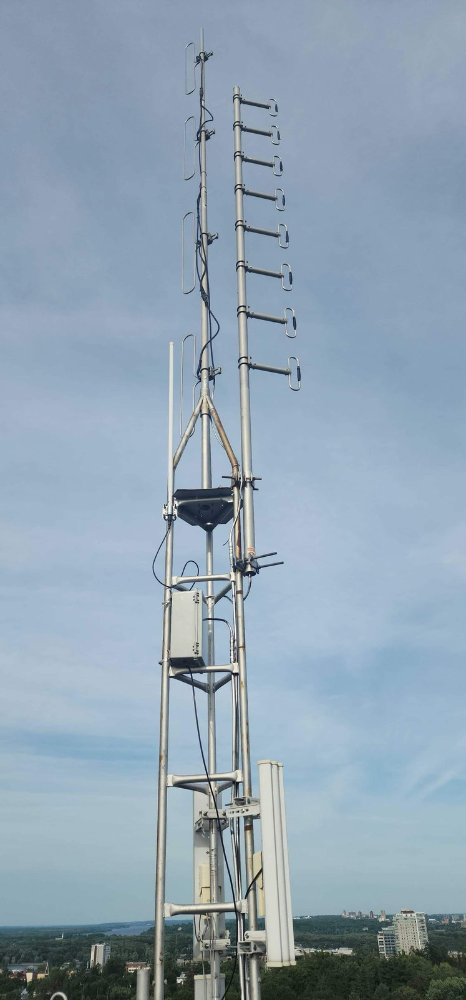

# Hosting an Ottawa Mesh Repeater on Your Property

## Frequently Asked Questions for Property Owners

Thank you for considering hosting an Ottawa Mesh repeater!

Click here to see a [Simplified brochure of this page](./images/property-owner-brochure.pdf).

Ottawa Mesh is a community-driven, open-source wireless network that uses low-power radio technology to provide text-only communications across Ottawa, Gatineau, and surrounding communities.

By hosting a repeater, you help extend the network's coverage, connect neighbourhoods, and build a more resilient communications infrastructure that operates independently of conventional cellular and internet services.

We've put together this FAQ to answer some common questions about what hosting a repeater involves.

---

## 1. Why should I host an Ottawa Mesh repeater?

- Your property becomes part of a growing community's communications network serving Ottawa and the surrounding region.
- You help improve communications resilience during cellular or internet outages.
- Your location may help connect otherwise isolated neighbourhoods and communities.
- You contribute to a free, open-source project built and maintained by local volunteers.
- Hosting a repeater is a practical way to support your local community without having to operate the network yourself.

## 2. What exactly is the repeater used for?

The repeater is part of a community-operated wireless mesh network called MeshCore.

- It receives and retransmits messages between compatible devices, extending the network's coverage.
- It allows people to exchange text messages without relying on cellular service or an internet connection.
- It helps connect distant neighbourhoods and other repeater installations.
- It provides an additional communications option during emergencies, power outages, and infrastructure disruptions.
- **Note that this will not replace celular networks, is not a replacement for 911, nor will it have the same range across our area.**

Repeaters operate automatically and do not require someone to monitor or operate them day to day.

## 3. What kind of equipment will be installed?

A typical installation consists of:

- A small, weatherproof enclosure containing a low-power radio and controller.
- An external antenna, usually mounted vertically on a mast or pole.
- A rechargeable battery.
- A small solar panel, or an alternative power arrangement where appropriate.

The equipment is relatively compact and lightweight. The exact configuration depends on the installation location, available mounting options, and expected coverage.

We will discuss the proposed equipment and installation with you before anything is installed.

## 4. How will the equipment be powered?

Most community repeaters are designed to operate independently using solar power and a rechargeable battery.

Depending on the location, a repeater may instead use an existing power source, such as Power over Ethernet (PoE).

The installation will be designed around the available resources and discussed with the property owner beforehand.

## 5. What kind of antenna or cabling will be involved?

A typical installation uses a small external antenna mounted on a mast, pole, or suitable existing structure.

- The antenna is generally lightweight and unobtrusive.
- Solar installations do not require a connection to your building's electrical system.
- PoE installations may require a cable between the repeater and its power source.
- Mounting methods may include existing masts, brackets, clamps, or other suitable hardware.

We will aim to use existing mounting points wherever possible and avoid drilling or making permanent modifications to the building.

Any required modifications or cabling will be discussed and approved in advance.

## 6. What is the expected maintenance requirement?

Repeaters are designed to operate autonomously for extended periods without human intervention, and can be managed remotely by people who manage repeater installs.

Occasional visits may be necessary for:

- Firmware updates.
- Battery and solar panel inspections.
- Antenna and mounting hardware checks.
- Troubleshooting or replacement of equipment.

Typically, these visits should be infrequent. We will coordinate any required access with you well in advance.

If the installation requires recurring access, we can establish mutually agreeable access arrangements.

## 7. How far will the repeater's signal reach?

Coverage depends on several factors, including:

- The height of the antenna above surrounding terrain.
- Whether there is a clear line of sight to other repeaters.
- Antenna type and gain.
- Surrounding buildings, trees, and other obstructions.
- Radio interference and environmental conditions.

Depending on the installation, a repeater may communicate with other nodes several kilometres away, sometimes considerably farther.

High-elevation installations are particularly valuable because they can connect multiple neighbourhoods and help form the backbone of the regional network.

Please see our [current coverage](../deployment/coverage.md) for more details.

There is no guaranteed coverage radius, as every installation is different.

## 8. Will the equipment interfere with my existing electronics?

MeshCore operates in the licence-exempt 902–928 MHz ISM radio band, using low-power radio transmissions. We currently use 910.525 MHz in Canada.

The equipment is designed to operate within applicable Canadian ISED radio-equipment requirements.

It operates in a different frequency range from typical Wi-Fi networks, cellular communications, and broadcast television.

Although interference is unlikely with properly selected and configured equipment, no radio installation can guarantee zero possibility of interference with every device.

We can provide equipment specifications and technical documentation if you or your building's technical staff would like to review the proposed installation.

## 9. What are the liability implications?

Hosting an Ottawa Mesh repeater is a voluntary arrangement between the property owner and the community members responsible for the installation.

The property owner carries the liability, though the likelihood of an incident is not material.

## 10. Are there permits, zoning, condo, or other regulatory requirements?

Requirements depend on the property, installation type, and applicable municipal, provincial, and federal regulations.

Some considerations include:

- Condo corporations or property management companies may have rules governing rooftop equipment and antennas.
- Commercial properties may have building-specific installation and access requirements.
- Landlords or property owners must authorize installations on their properties.

We recommend obtaining written permission before installation, particularly for rental properties, condominiums, and shared buildings.

Ottawa Mesh will work with the property owner to identify any requirements before proceeding.

## 11. Does the repeater or antenna pose any lightning-related concerns?

Most Ottawa Mesh repeaters are solar-powered, self-contained installations that do not require a connection to the building's electrical system.

As with any outdoor antenna or equipment mounted at an elevated location, we take reasonable precautions when selecting the mounting location and installation hardware.

The appropriate installation method depends on the property and the existing structure. Any specific grounding, bonding, or surge-protection requirements will be considered as part of the installation planning.

We will discuss any relevant safety considerations with the property owner before proceeding.

## 12. How long will the repeater remain on my property? Can I have it removed at any time?

Hosting a repeater is voluntary, and we want the arrangement to work for both the property owner and the community.

- We will work together to determine a clear timeframe or agreement as necessary.
- No long-term obligation required. You may request removal or remove it yourself at any time.

## 13. Will I have access to the network myself?

Hosting a repeater does not require you to use MeshCore, but you are welcome to participate.

You can use a compatible radio and the MeshCore mobile application to communicate with other members of the network. You can also create private channels for your own use.

Our community can help you get started by offering you a companion device if you're interested in exploring the technology.

---

## What Do Ottawa Mesh Installations Look Like?

Here are a few examples of existing repeater installations across the Ottawa region. Each installation is adapted to its location, available infrastructure, and coverage requirements.

### MAY_SOLAR_R – Mayfair Theatre

One of the earliest long-term repeaters mounted on the roof of the historic Mayfair Theatre. Serves Old Ottawa South, Carleton University, Riverside, and parts of downtown.

### CBC_FORTUNE_R1 – Camp Fortune

A high-elevation, PoE-powered backbone repeater helping connect much of the Ottawa region.

### Hull_Hospital – Hull

A high-elevation installation providing important cross-river connectivity between Gatineau and Ottawa.

### TOO_SOLAR_R – Ashton

A solar-powered, high-elevation repeater providing extended coverage across Ottawa's western rural communities, including Ashton, Beckwith, Munster, Kemptville, and Carleton Place.

[See more Ottawa Mesh repeater installations in our Repeater Showcase.](../deployment/repeaters-showcase.md)

---

## Interested in Hosting a Repeater?

We are always looking for suitable locations to expand Ottawa Mesh coverage.

Some of the most valuable locations include:

- Rooftops and elevated buildings.
- Grain Silos.
- Hilltops and properties with unobstructed views.
- Commercial and industrial buildings.
- Antenna and communications towers.
- Properties in areas where existing repeater coverage is limited.

You don't need to be a radio enthusiast or have any technical knowledge to participate. We can help assess the location, propose suitable equipment, and coordinate the installation.

**[Join the Ottawa Mesh Discord community](https://discord.com/invite/WSyNd8SfNr)**

Also feel free to browse any other section in this site for more information.

---

## Acknowledgements and Attribution

This FAQ is adapted from the [Property Owner FAQ published by Austin Mesh](https://www.austinmesh.org/about/property-owner-faq-hosting-a-node/).

We thank the Austin Mesh community for sharing their work and making it available for other community mesh networks to adapt and build upon.

**This page is an adapted work of the Austin Mesh Property Owner FAQ, used under the Creative Commons Attribution-ShareAlike 4.0 International (CC BY-SA 4.0) licence.**

Changes have been made to the original material, including adaptations for the Ottawa Mesh community, local terminology, installation examples, and Canadian context.

This adapted FAQ is also made available under the **CC BY-SA 4.0 International licence**.

[Read the CC BY-SA 4.0 licence](https://creativecommons.org/licenses/by-sa/4.0/).
